<h1 align="center">DEEPAK K</h1>

  <i>Robotics student from Bengaluru. Mostly ROS 2, embedded stuff, and lately VLA models.</i>

  <a href="https://deepxk.vercel.app">Portfolio</a> |
  <a href="https://www.linkedin.com/in/deepk6/">LinkedIn</a> |
  <a href="https://github.com/Deepakk-06">GitHub</a> |
  <a href="mailto:deepakk.hq@gmail.com">Email</a>

## About

Final-year EEE student. I started with Arduino robots (my first one was a human-following robot in class 12) and somehow ended up in physical AI.

I like the part of robotics that goes wrong: noisy sensors, drift, latency, hardware that doesn't behave. Simulation helps, but I don't trust anything until it runs on the bench.

## Right now

Working on SmolVLA, OpenVLA / OFT and ACT with LeRobot on an SO-101 arm.

## Stuff I've built

- [hexapod-6](https://github.com/Deepakk-06/hexapod-6): six-legged robot on a Jetson Orin Nano + STM32. The stock gait and IK code was a closed-source binary, so I rewrote it: servo driver, leg IK, tripod and wave gaits, SLAM and Nav2.
- [SENTINEL-SLAM](https://github.com/Deepakk-06/SENTINEL-SLAM): rover that maps and explores indoor spaces by itself. ROS 2, Gazebo, monocular depth with Depth Anything V2.
- [ROS 2 MPC Navigation](https://github.com/Deepakk-06/ROS2-Model-Predictive-Control-): MPC path tracking with obstacle avoidance on a TurtleBot3.
- [Soil Grain Detection](https://github.com/Deepakk-06/Soil-Grain-Detection-Mapping): YOLO on a Raspberry Pi.
- [skill-match](https://github.com/Deepakk-06/skill-match): a skills-first hiring platform.
- [quantum_research](https://github.com/Deepakk-06/quantum_research): QUBO / QAOA path planning.

## Wins

- Winner, NextGen Expo 2026 (team): OpenVLA-driven arm on a hexapod
- Runner-up, AI Expo Idea Lab 2026 (team): autonomous mobile robot with a vision-language model

## Stack

Python, C · ROS 2 (Jazzy), SLAM, kinematics, URDF · OpenVLA, SmolVLA, ACT, LeRobot, YOLOv8, OpenCV · MPC, PID, Jetson, STM32, Raspberry Pi, ESP32, Arduino · Gazebo, MuJoCo, RViz, MATLAB, KiCad, EasyEDA, Linux

## Listening

<!--LASTFM:START-->

  

<!--LASTFM:END-->

## Activity

<picture>
  <source media="(prefers-color-scheme: dark)"
    srcset="https://raw.githubusercontent.com/Deepakk-06/Deepakk-06/output/pacman-contribution-graph-dark.svg">
  <source media="(prefers-color-scheme: light)"
    srcset="https://raw.githubusercontent.com/Deepakk-06/Deepakk-06/output/pacman-contribution-graph.svg">
  

    
  

</picture>
