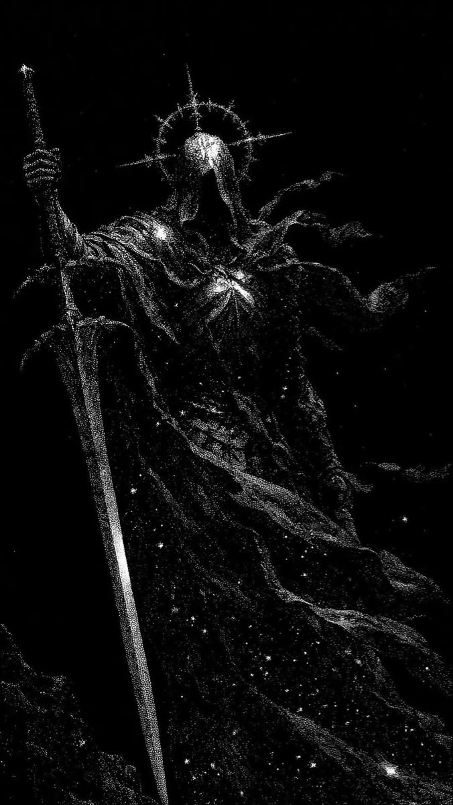

  

  

<h1 align="center">deepAk</h1>

  <i>Ashes don't ask whose house it was.</i> 🩸🔥

  
  

<h3 align="center">⚔️ EMBEDDED SYSTEMS · ROBOTICS · VLA RESEARCH ⚔️</h3>

  <b>"Doors are just walls that haven't met me yet."</b> 🩸

  

 

<h2 align="center">⚔️ The Warrior</h2>

Final-year **EEE** student. I build robots for the battlefield nobody puts in the demo: **noisy sensors, drift, latency, and hardware that refuses to behave.**

I fight across **SLAM-based mobile robots, legged robots, and manipulator arms**, and right now I'm hunting one question: **does domain randomization improve generalization in VLA (Vision-Language-Action) models?** Weapon of choice: OpenVLA in Isaac Sim.

Simulation is the rehearsal. **Hardware is the war.** I'd rather ship something that survives a bench full of loose wires than something that only lives in a clean simulator.

 

<h2 align="center">🩸 Conquered So Far</h2>

| Campaign | What I took |
| --- | --- |
| 🕷️ [**hexapod-6**](https://github.com/Deepakk-06/hexapod-6) | Six-legged autonomous robot. Jetson for high-level compute, STM32 for real-time servo control, ROS 2 for LiDAR SLAM and coordinated gaits. |
| 🛰️ [**SENTINEL-SLAM**](https://github.com/Deepakk-06/SENTINEL-SLAM) | Autonomous ROS 2 rover with LiDAR SLAM, Nav2, and real-time monocular depth (Depth Anything V2) streamed from a Pi to a GPU host. |
| 🎯 [**ROS2 MPC Navigation**](https://github.com/Deepakk-06/ROS2-Model-Predictive-Control-) | Model Predictive Control for autonomous navigation: trajectory tracking, path smoothing, real-time obstacle handling. |
| 🚫🌿 [**skill-match (Branchless)**](https://github.com/Deepakk-06/skill-match) | Skill-first hiring platform. No degree gatekeeping, just skills, projects, and real evidence. |
| 🌱 [**Soil Grain Detection**](https://github.com/Deepakk-06/Soil-Grain-Detection-Mapping) | YOLO-based soil grain detection and mapping, deployed on the edge for real-time assessment. |
| ⚛️ [**quantum_research**](https://github.com/Deepakk-06/quantum_research) | Research on QUBO and QAOA for traffic-aware path planning in delivery robots. |
| 🕹️ [**personal-portfolio**](https://github.com/Deepakk-06/personal-portfolio) | Retro-arcade portfolio with a Pong loader, 3D avatar, and live listening card. |

<h2 align="center">🗡️ Arsenal</h2>

  <b>Languages</b> 
  
  
  

  <b>Single-Board Computers</b> 
  
  

  <b>Microcontrollers</b> 
  
  
  

  <b>Frameworks & Tools</b> 
  
  
  
  
  
  

<h2 align="center">🔥 Currently At War</h2>

SENTINEL (quadruped AMR, LiDAR SLAM) &nbsp;·&nbsp; Hexapod on STS3215 servos &nbsp;·&nbsp; SO-101 follower arm &nbsp;·&nbsp; STM32-based embedded control &nbsp;·&nbsp; OpenVLA + domain randomization

<h2 align="center">📊 Battle Record</h2>

  
    
  
  

<h2 align="center">⌘ Commit Activity</h2>

<picture>
  <source media="(prefers-color-scheme: dark)"
    srcset="https://raw.githubusercontent.com/Deepakk-06/Deepakk-06/output/pacman-contribution-graph-dark.svg">
  <source media="(prefers-color-scheme: light)"
    srcset="https://raw.githubusercontent.com/Deepakk-06/Deepakk-06/output/pacman-contribution-graph.svg">
  

    
  

</picture>

<h2 align="center">🤝 Send a Raven</h2>

  
  &nbsp;
  
  &nbsp;
  
  &nbsp;
  

  <i>I came. I saw. I conquered. Now I'm building the next one.</i> ⚔️

  

