  

<h2 align="center">D E E P A K</h2>

<b>ROBOTICS &nbsp;·&nbsp; EMBEDDED SYSTEMS &nbsp;·&nbsp; VLA RESEARCH</b>

  Robotics and embedded systems engineer. 
  I build robots that survive contact with real hardware.

  <a href="https://deepxk.vercel.app">Arcade portfolio</a> ·
  <a href="https://www.linkedin.com/in/deepk6/">LinkedIn</a> ·
  <a href="mailto:deepakk.hq@gmail.com">Email</a>

 

## About

Final-year EEE student at New Horizon College of Engineering, Bengaluru, working across SLAM-based mobile robots, legged robots, and manipulator arms. My focus is the part that breaks first in the real world: noisy sensors, drift, latency, and hardware that refuses to behave.

I don't treat simulation as the finish line. A system isn't done until it runs on a bench full of loose wires.

**Focus areas:** legged locomotion · SLAM and navigation · model predictive control · embedded control · vision-language-action models

## Research

**Locomotion-aware VLA control: how does OpenVLA hold up when its camera sits on a walking base?**

Team research project (EEE, New Horizon College of Engineering). Vision-language-action models are evaluated on fixed or wheeled bases, never on a base that is walking. We're building a low-cost testbed to measure what gait-induced camera motion does to a pretrained policy.

- **Testbed:** hexapod re-actuated with 18 Feetech STS3215 servos, carrying a LeRobot SO-101 arm. Modeled in MuJoCo, with arm reach checked against the legs across standing and walking postures.
- **Protocol:** zero-shot OpenVLA vs LoRA fine-tuned OpenVLA vs a gait-phase-gated variant, across static, just-stopped and mid-gait conditions, on pick-and-place, push and stack tasks.
- **Status:** design and protocol done, simulation model built. Hardware build and trials are next. No results yet.

## Selected work

### [hexapod-6](https://github.com/Deepakk-06/hexapod-6)
*ROS 2 Humble · Jetson Orin Nano · 18× STS3215 servos · RPLidar A1M8*

A from-scratch walking stack for a six-legged robot. The stock gait and IK code shipped as a closed-source binary, so I rebuilt it: servo protocol driver, 3-DOF leg inverse kinematics, gait engines, calibration tooling, and SLAM + Nav2 navigation.

- IK/FK round-trip error **under 0.001 mm**, verified numerically before touching hardware
- Tripod and wave gaits with smootherstep foot trajectories to cut impact and jerk
- Nav2 parameters re-derived from the robot's measured geometry and speed, not tutorial defaults
- Root-caused a disabled I2C controller by reading the Jetson device tree directly

### [SENTINEL-SLAM](https://github.com/Deepakk-06/SENTINEL-SLAM)
*ROS 2 · SLAM Toolbox · Nav2 · Gazebo*

A differential-drive rover that maps, localizes, navigates, and explores indoor spaces with a 2D LiDAR and IMU.

- Frontier-based exploration node that sends Nav2 goals into unknown space
- Safety supervisor that filters unsafe velocity commands using live LiDAR ranges
- Map-quality monitor reporting explored, free, occupied and unknown ratios
- Monocular depth estimation with Depth Anything V2

### [ROS 2 MPC Navigation](https://github.com/Deepakk-06/ROS2-Model-Predictive-Control-)
*ROS 2 Jazzy · Gazebo Sim · Python · SciPy*

Nonlinear Model Predictive Control for path tracking on a TurtleBot3. Waypoints from CSV are smoothed into a cubic spline, then tracked by an MPC solving a 25-step horizon at 10 Hz.

- SLSQP solver with warm starting
- LaserScan-based soft-barrier cost for obstacle avoidance
- Demo video and RViz screenshots in the repo

### Also

[**Soil Grain Detection**](https://github.com/Deepakk-06/Soil-Grain-Detection-Mapping) (YOLO, edge deployment) · [**skill-match**](https://github.com/Deepakk-06/skill-match) (skills-first hiring platform) · [**quantum_research**](https://github.com/Deepakk-06/quantum_research) (QUBO / QAOA path planning)

## In progress

- **Hexapod + SO-101 testbed** for the research above: STS3215 servo stack, arm integration through LeRobot, data collection for LoRA fine-tuning
- **SENTINEL:** quadruped AMR with LiDAR SLAM
- **STM32-based embedded control**

## Skills

  

## Listening

<!--LASTFM:START-->

Recent tracks load here from Last.fm.

<!--LASTFM:END-->

## Activity

<picture>
  <source media="(prefers-color-scheme: dark)"
    srcset="https://raw.githubusercontent.com/Deepakk-06/Deepakk-06/output/pacman-contribution-graph-dark.svg">
  <source media="(prefers-color-scheme: light)"
    srcset="https://raw.githubusercontent.com/Deepakk-06/Deepakk-06/output/pacman-contribution-graph.svg">
  

    
  

</picture>
